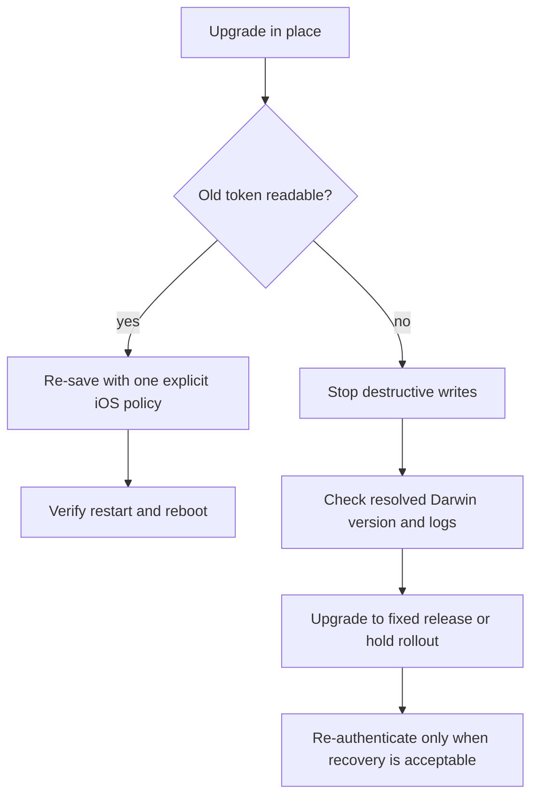

The safe choice for an iOS app that loses `flutter_secure_storage` values after an upgrade is to update to a release containing the Darwin Keychain compatibility fix, then verify old data before writing anything. Do not call `deleteAll()` or treat a `null` read as proof that the user never had a token. This case affects apps carrying Keychain items from older versions; a brand-new install has no legacy item to recover.

The issue is especially easy to misdiagnose because the app can look like a normal logout. A report opened against `flutter_secure_storage` 10.1.0 described values written by 10.0.0 becoming unreadable, while downgrading made them visible again. The package maintainer's fix explains the mechanism: older items used a `SecAccessControl` envelope, while a later query used a different `kSecAttrAccessible` and synchronizable attribute combination. The item still existed, but the new query could not see it, and a replacement write could fail with `errSecDuplicateItem`.

## Candidate decisions before changing the dependency

| Situation | Safer action | Why |
| --- | --- | --- |
| Existing iOS users have refresh tokens or device secrets | Upgrade to `11.2.0` or a later release and run a read smoke test | The 11.2.0 changelog includes the Darwin lookup fix across accessibility levels |
| The app is pinned to 10.0.x temporarily | Hold the version and stop the rollout | 10.1.0 introduced a compatibility failure for some pre-existing items |
| The value is only a disposable access token | Re-authenticate only after a confirmed read failure | Losing a session is recoverable; deleting unknown Keychain data is not |
| The value is a recovery key, wallet seed, or offline credential | Pause the rollout and design an explicit recovery path | A forced logout is not an acceptable migration strategy |

The version numbers above are checked against the package changelog on 2026-10-16. They are release facts, not a claim that every app has the same dependency graph. Check `pubspec.lock` and the resolved `flutter_secure_storage_darwin` version in CI before shipping.

## The upgrade and verification sequence

Use the current package line in a branch first. The important part is preserving the old installation long enough to test an upgrade, not installing the new version over a wiped simulator.

```yaml
dependencies:
  flutter_secure_storage: ^11.2.0
```

Then run a real upgrade test with this order:

1. Install the old app on an iOS device or a simulator that keeps its Keychain.
2. Write a test token with the production key name.
3. Upgrade the package without uninstalling the app.
4. Launch the new build and call `read` and `containsKey` before any repair write.
5. Only if the old value is readable, write it back with the new explicit options.
6. Repeat after a force-quit and device reboot. Also test a clean install separately.

This distinction matters: uninstalling the app, resetting the simulator, or changing the bundle identifier removes the very state needed to reproduce the migration.

## Keep one iOS option policy

`flutter_secure_storage` exposes Keychain accessibility through `IOSOptions`. The package documentation says the default `unlocked` value is available only while the device is unlocked, while `first_unlock` becomes available after the first unlock following a reboot. Pick the least permissive option that matches the app's background behavior and use it consistently for new reads and writes.

The following helper makes the migration conservative. It never replaces a missing value with an empty string, and it does not erase a key just because one query returned `null`.

```dart
import 'package:flutter_secure_storage/flutter_secure_storage.dart';

class TokenStore {
  TokenStore()
      : _storage = const FlutterSecureStorage(
          iOptions: IOSOptions(
            accessibility: KeychainAccessibility.first_unlock,
          ),
        );

  final FlutterSecureStorage _storage;

  Future<String?> readRefreshToken() {
    return _storage.read(key: 'refresh_token');
  }

  Future<bool> hasRefreshToken() {
    return _storage.containsKey(key: 'refresh_token');
  }

  Future<void> migrateReadableToken() async {
    final value = await _storage.read(key: 'refresh_token');
    if (value == null || value.isEmpty) {
      return;
    }

    // Re-saving a readable item lets the package update its native envelope.
    await _storage.write(key: 'refresh_token', value: value);
  }
}
```

The helper is not a magic repair for an item that the native query cannot find. Its purpose is to make a successful read idempotent and to avoid turning an ambiguous read into destructive recovery. If `readRefreshToken()` returns `null` after the upgrade, capture the package version, iOS version, and error logs, then use the fixed release or hold the rollout. Do not immediately generate a new token and overwrite the same key: an invisible old item can make that write report “the specified item already exists.”

The `first_unlock` choice is an example, not a universal recommendation. A foreground-only secret may be better protected with `unlocked`. A background refresh flow cannot assume the phone is currently unlocked, but it still needs a product decision about whether that trade-off is acceptable.

## A small release gate catches the regression

Add this checklist to the iOS upgrade ticket rather than relying on a manual login test.

```text
[ ] Existing app upgraded in place; no uninstall or Keychain reset
[ ] Old token read before any write or delete
[ ] containsKey and read checked separately
[ ] Force-quit and reboot paths checked
[ ] errSecDuplicateItem captured as a migration signal
[ ] Clean install tested as a separate case
[ ] Rollback version and re-authentication policy documented
```

The package's 11.2.0 changelog lists a Darwin fix that searches Keychain items across accessibility levels. That improves the default recovery path, but it does not remove the need to test the exact old package and native plugin combination shipped to users. Flutter plugins are federated packages, so a Dart constraint can look correct while a stale lockfile or cached native dependency keeps the old behavior in the build.



The key observation is whether the old item is still present, not whether the first `read` returned a string. A missing value, a Keychain accessibility mismatch, a native plugin regression, and a genuinely expired token require different actions.

## Practical summary

`flutter_secure_storage` 10.1.0 can expose a production-only iOS migration trap: old Keychain items may survive physically while becoming invisible to the new query. Upgrade through a release with the Darwin compatibility fix, test an in-place upgrade, choose one `IOSOptions` policy, and never delete or overwrite an unreadable key until the failure is classified. For ordinary session tokens, a controlled re-login can be a fallback. For irreplaceable secrets, it is not a migration plan.

Sources checked on 2026-10-16: [`flutter_secure_storage` package documentation](https://pub.dev/packages/flutter_secure_storage), [package changelog](https://pub.dev/packages/flutter_secure_storage/changelog), [issue #1158](https://github.com/juliansteenbakker/flutter_secure_storage/issues/1158), and [fix #1183](https://github.com/juliansteenbakker/flutter_secure_storage/pull/1183).
