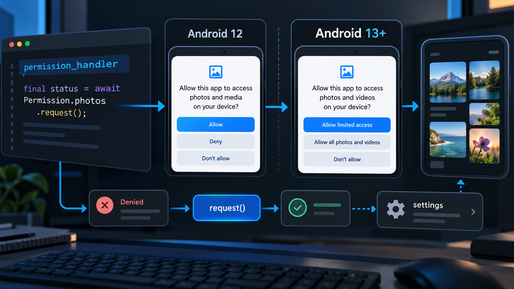

If a Flutter app uses `permission_handler` on Android and sends every `denied` status straight to Settings, migrate that branch now. With `permission_handler_android` 14.1.0, Android `status` no longer reports `permanentlyDenied`; only `request()` can return it. This is safer for users who changed a permission back to “Ask every time”, but it breaks the old pre-check pattern. It does not change iOS, where a status check can still return `permanentlyDenied`.

The failure looks like a settings loop: the user returns from Settings, the app reads `denied`, skips the system dialog, and opens Settings again. The app is not missing a permission declaration at that point. Its decision is based on information Android does not expose through a status read.

## What changed in the Android decision

The package's [14.1.0 changelog](https://github.com/Baseflow/flutter-permission-handler/blob/main/permission_handler_android/CHANGELOG.md) documents the behavior change. Android cannot distinguish “never requested”, “Ask every time”, and “permanently denied” during a plain status check, so all three can appear as `denied`.

| Device state | `permission.status` on Android | `permission.request()` | App action |
| --- | --- | --- | --- |
| Never requested | `denied` | Shows dialog | Explain, then request |
| Denied once | `denied` | Shows dialog again | Respect the new result |
| Denied permanently | `denied` | Returns `permanentlyDenied` immediately | Offer Settings |
| Reset to “Ask every time” | `denied` | Shows dialog | Do not send to Settings first |
| Granted | `granted` | Returns `granted` immediately | Continue |

The image is useful as a debugging boundary: the status read can decide whether a request is needed, but the request result decides whether the app must recover through Settings.

## Replace the pre-check, not just the package version

Keep permission policy in one service. The important change is that every non-granted Android permission reaches `request()`.

```dart
import 'package:permission_handler/permission_handler.dart';

Future<bool> ensureCameraPermission() async {
  final permission = Permission.camera;
  final current = await permission.status;

  if (current.isGranted) {
    return true;
  }

  // Safe on Android even when the permission is permanently denied:
  // the platform returns immediately without showing a dialog.
  final result = await permission.request();

  if (result.isGranted) {
    return true;
  }

  if (result.isPermanentlyDenied) {
    await openAppSettings();
  }

  return false;
}
```

Avoid this older pattern:

```dart
final status = await Permission.camera.status;
if (status.isPermanentlyDenied) {
  await openAppSettings();
  return false;
}
```

On current Android support, that branch is not a reliable way to identify permanent denial. Also avoid persisting a permanent-denial flag as a permanent product decision. A user can change the permission in Settings, so refresh the status after the app resumes and let the next feature action call `request()` again.

## Upgrade and test the migration boundary

`permission_handler` 13.0.2 depends on the Android implementation containing this fix. That implementation requires compile SDK 37 according to the [official migration guide](https://github.com/Baseflow/flutter-permission-handler/blob/main/ANDROID_PERMANENTLY_DENIED_FIX_GUIDE.md).

```gradle
android {
    compileSdk = 37
}
```

Confirm the resolved transitive version rather than assuming the top-level constraint changed it:

```bash
flutter pub get
grep -A 3 "^  permission_handler_android:" pubspec.lock
```

Use this checklist for a reproducible regression pass. It is a test plan, not a claim that every device combination was tested here.

```text
[ ] Fresh install: first denial stays in the feature flow, not Settings
[ ] Second denial: request() returns permanentlyDenied and Settings is offered
[ ] Settings -> Ask every time: the next feature action shows the system dialog
[ ] App resume: cached permission state is refreshed
[ ] iOS: existing status-based behavior still passes
[ ] Release build: manifest and compileSdk match the requested permission
```

The upstream [Android guide](https://github.com/Baseflow/flutter-permission-handler/blob/main/ANDROID_PERMANENTLY_DENIED_FIX_GUIDE.md) explicitly says not to derive permanent denial from `shouldShowRequestRationale`. That value is an Android implementation signal, not a stable product state. Treat `status` as a cheap preflight, `request()` as the decision point, and Settings as recovery only after the request result says it is necessary.

This migration is not about showing the permission dialog more often. It is about preserving a valid retry path after a user changes the OS setting. A first denial should remain recoverable in-app; only a request result of `permanentlyDenied` should move the user toward Settings.
