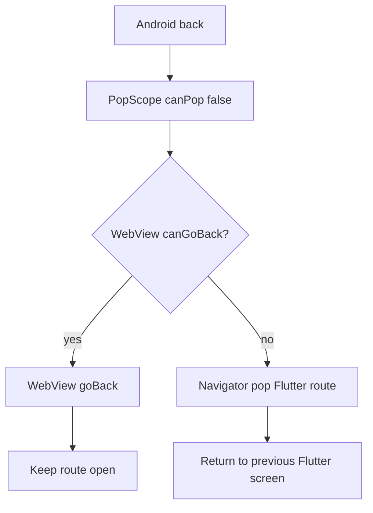

The safe choice for a Flutter screen that embeds a website is to consume Android back in two stages: call `WebViewController.goBack()` while the page has browser history, then pop the Flutter route only when that history is empty. This applies to `webview_flutter` 4.x screens that should behave like a browser. It does not fit a screen where the WebView is only a static login or checkout surface and every back press should leave the route.

## Why the default back behavior is wrong

`webview_flutter` exposes `canGoBack()` and `goBack()`, but those methods only operate on the native WebView history. Flutter's system back gesture or Android back button operates on the enclosing `Route`. The two histories are separate.

| Back state | Desired action | Bug when the histories are not connected |
| --- | --- | --- |
| WebView has `A → B` history | Go from B to A | The Flutter page closes instead |
| WebView is already at its first page | Pop the Flutter route | The app appears stuck if pop is always blocked |
| A back request is still awaiting `canGoBack()` | Ignore the duplicate request | Two requests can pop the route twice |

The package documentation defines `canGoBack()` as a check for a WebView history item and `goBack()` as navigation inside that history. The Flutter `PopScope` documentation separately explains that `canPop: false` prevents the enclosing route from being popped while still reporting the attempted pop. That distinction is the key to the fix.

## A reproducible setup

This example uses `webview_flutter: ^4.14.1`, whose current controller is created before the `WebViewWidget` is inserted. The version is the one shown on pub.dev when this post was checked on 2026-11-12; resolve the version already supported by your Flutter SDK instead of copying it blindly.

```yaml
dependencies:
  flutter:
    sdk: flutter
  webview_flutter: ^4.14.1
```

The failure case is easy to reproduce conceptually: load a page, tap an internal link, then press Android back. If the screen is wrapped in a normal route without a back policy, the route may close before the WebView gets a chance to return to its previous document.

## Keep the route until WebView history is exhausted

The important detail is that `canPop` stays `false`. The callback must decide what to do after the back attempt. Making `canPop` depend on an asynchronous `canGoBack()` result is not reliable because `PopScope.canPop` is a synchronous widget property.

```dart
import 'package:flutter/material.dart';
import 'package:webview_flutter/webview_flutter.dart';

class BrowserPage extends StatefulWidget {
  const BrowserPage({super.key, required this.initialUrl});

  final Uri initialUrl;

  @override
  State<BrowserPage> createState() => _BrowserPageState();
}

class _BrowserPageState extends State<BrowserPage> {
  late final WebViewController _controller;
  bool _handlingBack = false;

  @override
  void initState() {
    super.initState();
    _controller = WebViewController()
      ..setJavaScriptMode(JavaScriptMode.unrestricted)
      ..loadRequest(widget.initialUrl);
  }

  Future<void> _handleBack() async {
    if (_handlingBack) return;
    _handlingBack = true;

    try {
      if (await _controller.canGoBack()) {
        await _controller.goBack();
      } else if (mounted) {
        Navigator.of(context).pop();
      }
    } finally {
      _handlingBack = false;
    }
  }

  @override
  Widget build(BuildContext context) {
    return PopScope<void>(
      canPop: false,
      onPopInvokedWithResult: (didPop, result) {
        if (!didPop) {
          _handleBack();
        }
      },
      child: Scaffold(
        appBar: AppBar(title: const Text('Browser')),
        body: WebViewWidget(controller: _controller),
      ),
    );
  }
}
```

The `didPop` guard matters. If another part of the app successfully pops the route, the callback should not start a second asynchronous navigation. `_handlingBack` covers the smaller but common race where a user presses the hardware button twice before the first platform call returns.

The image to watch is the direction of control: Android back enters `PopScope`, WebView history is checked, and only the no-history branch reaches `Navigator.pop`.



## Traps that look like fixes

`WillPopScope` examples still appear in older snippets, but new code should use `PopScope`; Flutter marks `onPopInvoked` as deprecated in favor of `onPopInvokedWithResult`. Mixing the old callback with a current `PopScope` can produce migration warnings and hides whether the route actually popped.

Do not call `Navigator.pop` first and then `goBack`. Once the route is removed, the WebView state may be disposed, so the second action cannot restore the page the user expected.

Do not treat `goBack()` as a boolean. It returns `Future<void>` and is a no-op when there is no history. The explicit `canGoBack()` check is still useful because the app needs a different action—route pop—when history is empty.

If the screen uses a nested `Navigator`, replace `Navigator.of(context).pop()` with the navigator that owns this page. A WebView history item should not accidentally pop a tab shell or the root navigator. The practical checklist is:

- [ ] `webview_flutter` controller is retained for the lifetime of the page.
- [ ] `PopScope.canPop` is `false` while async WebView state is being checked.
- [ ] `didPop` is checked before starting custom handling.
- [ ] `canGoBack()` is awaited before deciding between `goBack()` and route pop.
- [ ] Duplicate back requests are ignored or serialized.
- [ ] The route used by `Navigator.pop` is the route that owns the WebView.

## Short takeaway

`webview_flutter` history and Flutter route history are different state machines. Keep the route from popping synchronously, check the WebView history asynchronously, and pop the route only when there is no page left to revisit. This preserves normal Android browser behavior without requiring custom native back-button code.

Sources: [webview_flutter package documentation](https://pub.dev/documentation/webview_flutter/latest/), [`WebViewController.canGoBack`](https://pub.dev/documentation/webview_flutter/latest/webview_flutter/WebViewController/canGoBack.html), [`WebViewController.goBack`](https://pub.dev/documentation/webview_flutter/latest/webview_flutter/WebViewController/goBack.html), and [Flutter `PopScope` API](https://api.flutter.dev/flutter/widgets/PopScope-class.html).
