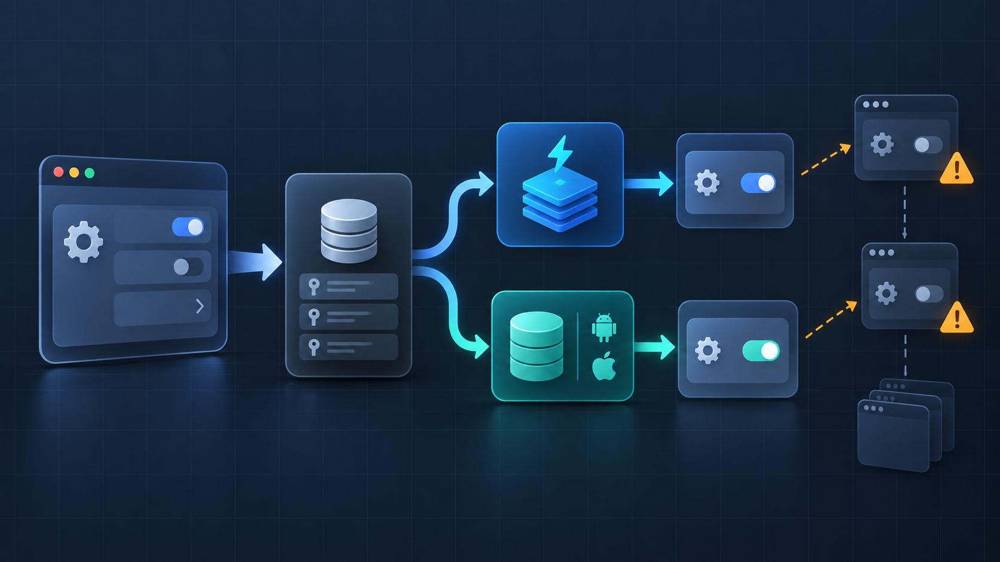

If a Flutter screen starts a Dio request that no longer matters after navigation, use `autoDispose` and cancel it. If the request succeeds, keep that result alive; if it fails or is cancelled, let the next visit try again. This policy fits search results, detail pages, and previews. It is not a good default for a write operation that must finish after the user leaves the page.

## The production bug is usually a policy mix-up

`autoDispose` does not mean “cancel every Future immediately.” Riverpod waits until the provider has no listeners, then gives it a frame before disposing it. A request can therefore finish after a route starts leaving, while a result can also disappear on every tab switch if it was never kept alive.

| Situation | Desired behavior | Lifecycle choice |
| --- | --- | --- |
| User changes a search query | Stop the obsolete request | `autoDispose` + `ref.onDispose` |
| Detail GET succeeds | Reopen without another GET for a while | Call `ref.keepAlive()` after success |
| Detail GET fails | Retry when the screen is revisited | Do not keep the failed state alive |
| Payment or upload starts | Finish or resume deliberately | Do not tie the operation to a page provider |

The important boundary is after the network call completes. Calling `keepAlive()` before `await` turns a temporary screen request into a cache even when the request later fails.

## A cancellable provider with a success-only cache

The following example uses a plain `FutureProvider.autoDispose`, so the same lifecycle is visible without generated code. The `CancelToken` is created inside the provider and closed through `ref.onDispose`.

```dart
final productProvider = FutureProvider.autoDispose.family<Product, String>(
  (ref, productId) async {
    final cancelToken = CancelToken();

    // The provider owns the request, so disposal owns cancellation too.
    ref.onDispose(cancelToken.cancel);

    try {
      final response = await ref.read(apiProvider).get<Map<String, dynamic>>(
        '/products/$productId',
        cancelToken: cancelToken,
      );

      // Cache only a completed, valid response.
      ref.keepAlive();
      return Product.fromJson(response.data!);
    } on DioException catch (error) {
      if (CancelToken.isCancel(error)) {
        // The screen disappeared or the family parameter changed.
        // Let Riverpod discard this failed attempt.
        throw RequestCancelled();
      }
      rethrow;
    }
  },
);
```

`family` makes the cache key include `productId`, which is also why `autoDispose` matters. Without disposal, every distinct parameter can leave a provider state in memory. The provider should depend on a stable `apiProvider`; creating a new Dio instance on every rebuild makes cancellation and connection reuse harder to reason about.

The UI does not need to know whether the request was cancelled by navigation or by a changed parameter. Both cases are stale work from the screen's point of view:

```dart
class ProductPage extends ConsumerWidget {
  const ProductPage({required this.productId, super.key});

  final String productId;

  @override
  Widget build(BuildContext context, WidgetRef ref) {
    final product = ref.watch(productProvider(productId));

    return product.when(
      loading: () => const CircularProgressIndicator(),
      error: (error, stack) => ErrorView(onRetry: () {
        ref.invalidate(productProvider(productId));
      }),
      data: (value) => ProductView(value),
    );
  }
}
```

## Why `keepAlive` belongs after `await`

There are two different costs: an in-flight request and a completed result. Cancelling the first saves radio, battery, and server work when the result is no longer needed. Keeping the second avoids a duplicate GET when a user returns to the same page.

```text
screen enters
    │
    ├─ request running ── screen leaves ── dispose ── cancel
    │
    └─ request succeeds ── keepAlive ── screen leaves ── retain result
```

Do not use `ref.keepAlive()` as a repair for a provider that is recomputed. A recomputation destroys the previous state even when automatic disposal is disabled. If the family argument, watched dependency, or authentication scope changes, treat that as a new request and decide whether the old result is still valid.

## Checks that catch the edge case

The useful test is not only “the widget eventually shows data.” It should prove both the cancellation and cache contracts.

| Test | Assertion |
| --- | --- |
| Dispose before response | Dio receives `CancelToken.cancel()` and no stale state is rendered |
| Successful response, revisit | The same provider state is reused without a second GET |
| HTTP 500, revisit | A new GET is attempted |
| Two product IDs | Each family instance has its own request and cache |
| Manual invalidation | A fresh request replaces the kept result |

For a search box, add debounce before the provider or use the request client's cancellation support. For a mutation, move the Future into a notifier or repository owned by the feature, show its progress explicitly, and make retry/idempotency part of the API contract. A page disappearing is not evidence that a server-side write should be rolled back.

## Short rule set

Use `autoDispose` for screen-scoped reads, register cancellation in `ref.onDispose`, and call `ref.keepAlive()` only after a successful response. Keep failures disposable so retry remains natural. When the operation changes server state, separate its lifetime from the route instead of silently cancelling it with the widget.

Sources checked 2026-11-15: [Riverpod request cancellation](https://riverpod.dev/docs/how_to/cancel), [Riverpod automatic disposal](https://riverpod.dev/docs/concepts2/auto_dispose), and [Riverpod auto-dispose caching guidance](https://docs-v2.riverpod.dev/docs/essentials/auto_dispose).
