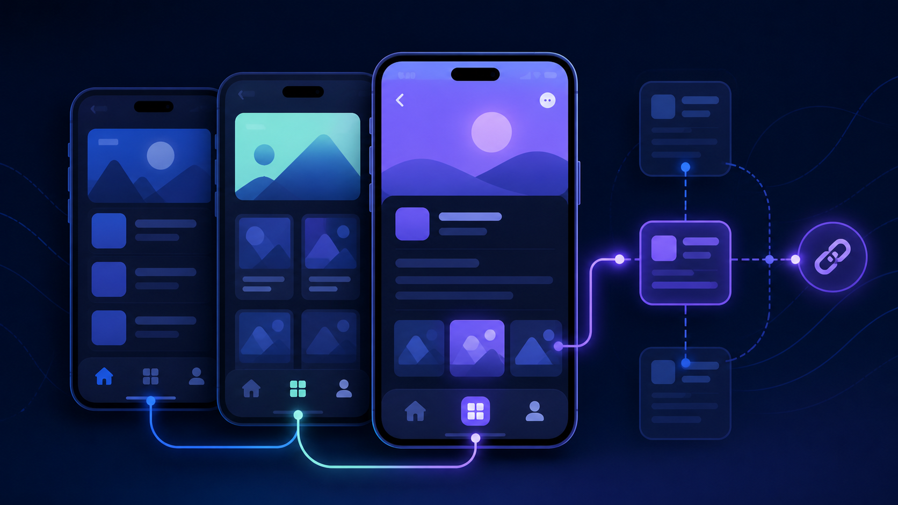

The key detail in this diagram is the handoff from an external link to one validated router action.

The safe `app_links` 7 migration is to treat link delivery as an input stream, not as a one-time callback. Upgrade the native lifecycle integration, subscribe once at app startup, and deduplicate the same URI before calling `go_router`. This fits apps that must handle cold start and resumed links; it does not replace server-side authorization or route validation.

## Why the old implementation breaks

An app that migrated from `uni_links` or `app_links` 5/6 often has both of these paths:

```dart
final initial = await appLinks.getInitialLink();
appLinks.uriLinkStream.listen(_openLink);
```

That looks complete, but the same URL can arrive through the initial lookup and the stream during startup. A second navigation may pop a login redirect, open a detail page twice, or consume a one-time invite twice. The failure is timing-dependent, so a warm-device manual test can miss it.

`app_links` 6 changed the API names to `getInitialLink()` and `uriLinkStream`. The 7.x line also targets Flutter's newer iOS scene lifecycle. The package changelog documents the migration boundary and later fixes for Android launch-link resends, links received before the first listener, and iOS scene delivery. Check the exact package version against the Flutter SDK before changing Dart code.

## One delivery service with an explicit boundary

Keep plugin events away from widgets. The service below accepts both startup lookup and later stream events, but only forwards a canonical URI once while it is in flight.

```dart
import 'dart:async';

import 'package:app_links/app_links.dart';

typedef LinkHandler = Future<void> Function(Uri uri);

class DeepLinkInbox {
  DeepLinkInbox(this._handle);

  final AppLinks _appLinks = AppLinks();
  final LinkHandler _handle;
  StreamSubscription<Uri>? _subscription;
  final Set<String> _inFlight = <String>{};

  Future<void> start() async {
    _subscription = _appLinks.uriLinkStream.listen(
      (uri) => _accept(uri),
      onError: (Object error, StackTrace stack) {
        // Record the platform error; do not navigate from an error callback.
      },
    );

    final initial = await _appLinks.getInitialLink();
    if (initial != null) {
      await _accept(initial);
    }
  }

  Future<void> _accept(Uri uri) async {
    final key = uri.normalizePath().toString();
    if (!_inFlight.add(key)) return;
    try {
      await _handle(uri);
    } finally {
      _inFlight.remove(key);
    }
  }

  Future<void> dispose() async {
    await _subscription?.cancel();
  }
}
```

`inFlight` is deliberately short-lived. It stops two deliveries racing during startup, but it does not permanently discard a later legitimate visit to the same URL. If the product must suppress repeats for minutes, store a bounded event ID or timestamp in a separate policy layer instead of changing the plugin adapter.

The router handler should validate before navigation:

```dart
final inbox = DeepLinkInbox((uri) async {
  if (uri.scheme != 'acme' || uri.host != 'open') return;
  final path = uri.pathSegments;
  if (path.length != 2 || path.first != 'orders') return;

  final orderId = path.last;
  router.go('/orders/${Uri.encodeComponent(orderId)}');
});
```

## Migration and verification table

| Check | Old assumption | Production-safe decision |
| --- | --- | --- |
| API names | `getInitialAppLink` or `allUriLinkStream` | Use `getInitialLink` and `uriLinkStream` on app_links 6+ |
| iOS lifecycle | AppDelegate callback is enough | Follow the 7.x Flutter scene migration for the pinned SDK |
| Startup delivery | One `Future` owns the link | Subscribe once and dedupe lookup plus stream |
| Navigation | Any URI is safe to route | Validate scheme, host, path, and auth state |
| Testing | Tap a link while the app is open | Test terminated, backgrounded, rebuilt Activity, and repeated delivery |

Use a reproducible matrix rather than relying on one simulator run:

1. Launch a signed Android build from a terminated state and send the same link twice with `adb shell am start -a android.intent.action.VIEW -d 'acme://open/orders/42'`.
2. On iOS, test a universal link after terminating the app and again after suspending it. Verify that the scene lifecycle reaches the same inbox.
3. Rebuild the Android Activity while the app is open, then confirm that one external link produces one router action.
4. Unit-test `_accept` with two concurrent calls and assert that the handler runs once; test a later call after the first handler completes separately.

The practical boundary is simple: `app_links` transports platform events, the inbox decides whether an event is new, and `go_router` receives only validated application locations. That separation makes the v6-to-v7 migration reviewable and keeps duplicate delivery from becoming duplicate business actions.

Sources checked 2026-11-17: [app_links changelog](https://pub.dev/packages/app_links/changelog), [AppLinks API](https://pub.dev/documentation/app_links/latest/app_links/AppLinks-class.html), and [Flutter app links setup](https://docs.flutter.dev/cookbook/navigation/set-up-app-links).
